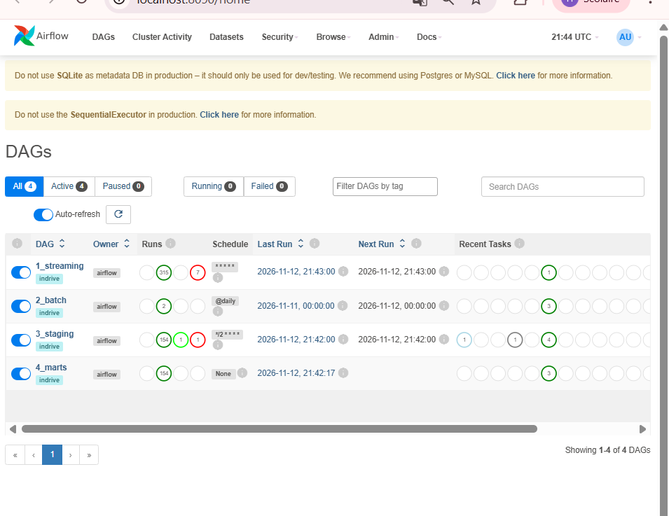

# InDrive Ride Pipeline

A small data pipeline for an InDrive-style ride-hailing platform in Casablanca, built for the Data Maroc Bootcamps (Data Engineering Fundamentals).

It uses **Airflow**, **Postgres** and **Docker**, with three layers: `raw` → `staging` → `mart`.



## How it works

| DAG | Schedule | What it does |
|---|---|---|
| `1_streaming` | every minute | Calls an API and loads ride events into `raw.rides` |
| `2_batch` | daily | Loads `drivers`, `vehicles` and `zones` from CSV files into `raw` |
| `3_staging` | every 2 minutes | Waits for the sources, cleans the data in parallel, then triggers `4_marts` |
| `4_marts` | triggered | Builds the analytics tables for analysts |

**Layers**
- `raw`: data exactly as it arrives.
- `staging`: cleaned data (no phone numbers, trimmed text, no duplicates, no zero fares, no unknown drivers).
- `mart`: tables ready for analysis (`rides`, `revenue_by_zone`, `driver_leaderboard`).

Every staging and mart table is rebuilt with `DROP TABLE` + `CREATE TABLE AS`, so re-running the pipeline never creates duplicates.

## Project structure

```
dags/         Airflow DAGs and the database helper (db.py)
sql/staging/  Cleaning queries
sql/mart/     Analytics queries
postgres/     init.sql (creates the schemas and raw tables)
data/         drivers.csv, vehicles.csv, zones.csv
docker-compose.yml
WORKSHEET.md  Answers to the exercise questions
```

## How to run

You need Docker Desktop.

```bash
docker compose up -d
```

Then:
- Airflow: http://localhost:8090 (username `admin`)
- Adminer (database viewer): http://localhost:8085 (system PostgreSQL, server `postgres`, user `indrive`, password `indrive`, database `indrive`)

To get the Airflow password:

```bash
docker compose exec airflow cat /opt/airflow/standalone_admin_password.txt
```

On Windows Git Bash, put `MSYS_NO_PATHCONV=1` in front of the command.

Turn on the 4 DAGs in Airflow. After a few minutes they should all be green.

To stop the project, use `docker compose stop`. Do not use `docker compose down -v`, because it deletes the database.

## Check the results

```bash
docker compose exec postgres psql -U indrive -d indrive -c "SELECT * FROM mart.revenue_by_zone ORDER BY revenue DESC;"
```

## Notes

The ride events come from the fake API `dummyjson.com/carts`. It only imitates a live source (fresh JSON every minute), and each cart is turned into a ride. About 5% of rides point to an unknown driver and about 3% have a fare of 0, on purpose, to test the cleaning step.
